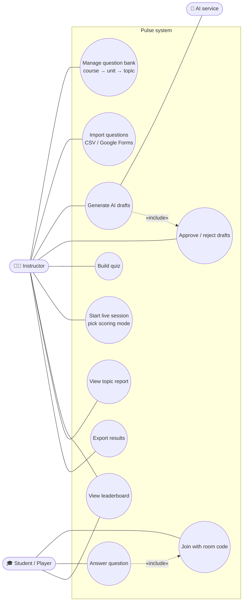
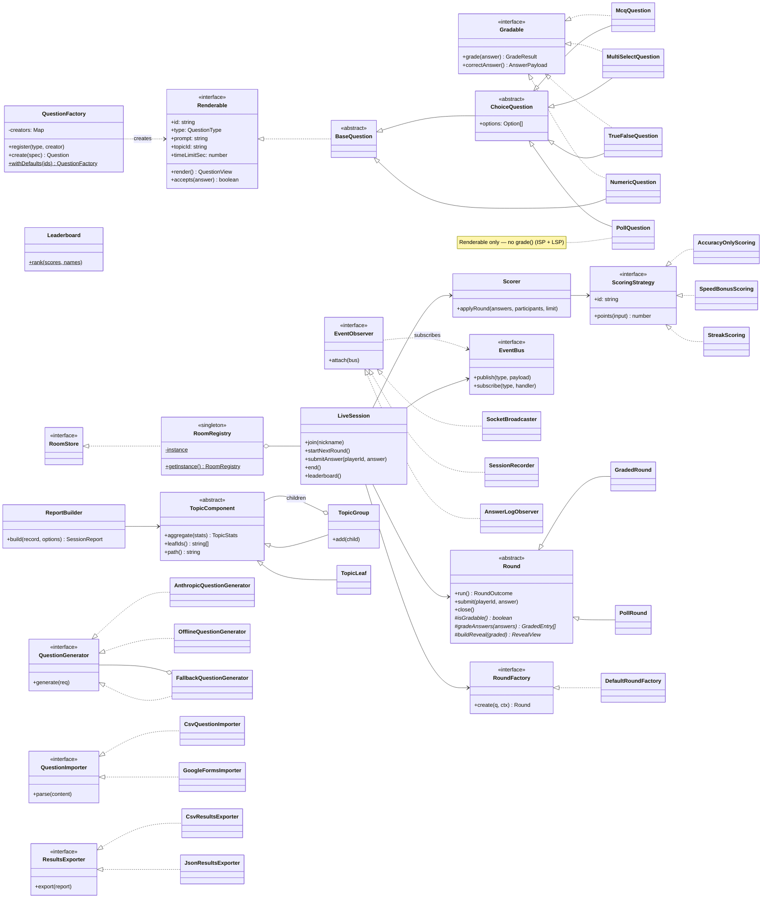
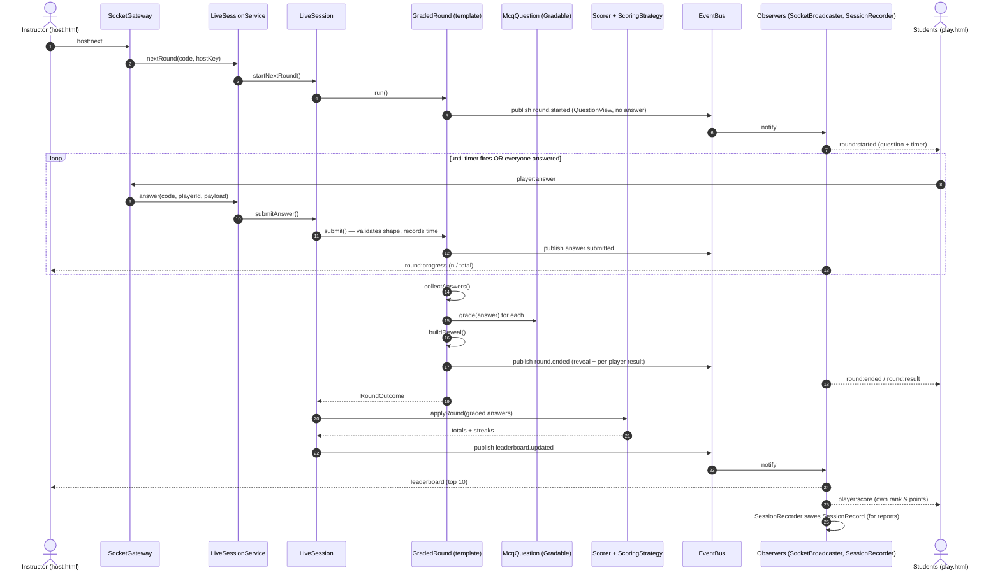
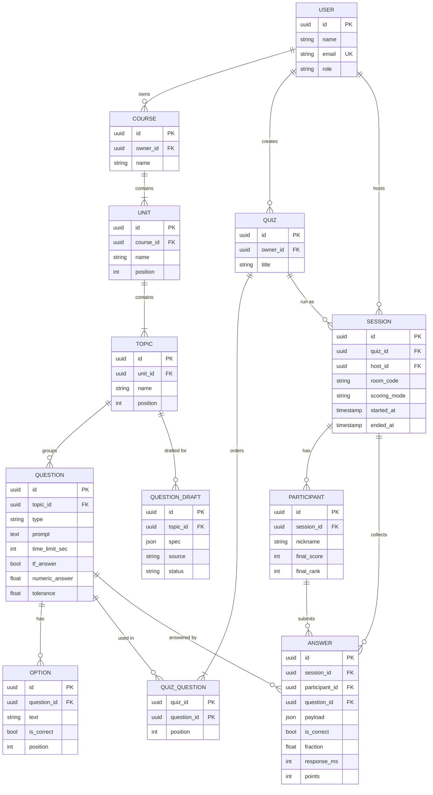

# Pulse — UML & ER diagrams

All diagrams are [Mermaid](https://mermaid.js.org/). They render directly on GitHub, in VS Code
(Markdown Preview Mermaid Support extension) or at <https://mermaid.live> — paste a block there to export PNG/SVG for slides.

---

## 1. Use-case diagram

Mermaid has no native use-case diagram, so this is drawn as a flowchart (actors on the outside, use cases in the system boundary).

---

## 2. Class diagram

---

## 3. Sequence diagram — one full round

---

## 4. ER diagram

Matches `docs/schema.sql`.

